# Assignment 2: Transfer Learning — TensorFlow Flowers

Фактичний звіт · Python / Jupyter · 31.10.2026 (основний запуск) та 01.11.2026 (розширення: VGG16 і додаткові режими заморожування)

## 1. Мета та умови

Порівняти класичні класифікатори на ознаках 3 pretrained CNN для класифікації пʼяти квіткових класів. Окремо дослідити, як точність залежить від глибини заморожених шарів MobileNetV2, побудувати матриці помилок і пояснити характерні помилки.

Джерело умов: надана презентація Labs.pdf, слайд 14. Частки: confusion matrices 60%, accuracy trend 20%, typical errors 20%. Конкретні CNN, датасет і протокол є рішеннями проєкту.

Усі числа, криві та прогнози в цьому звіті одержані фактичним виконанням коду, а не підставлені як очікувані результати.

| Критерій | Частка | Реалізація |
| --- | --- | --- |
| Confusion matrices | 60% | 18 матриць + 2 для обраної CNN |
| Accuracy trend | 20% | 9 реально навчених режимів заморожування |
| Typical errors | 20% | Фото, частоти пар у всіх моделях, категорії причин |

## 2. Дані та контроль якості

TensorFlow Flowers містить 3670 фотографій. Порядок класів із TFDS: dandelion, daisy, tulips, sunflowers, roses. JPEG узято з того самого офіційного архіву, який використовує TFDS; перевірено SHA-256 архіву й кожного файлу.

Знайдено 3667 унікальних побайтових хешів: 3 пари дублікатів. Одна пара має мітки roses і tulips. Збережено всі офіційні записи й labels; стратифікація виконується на групах SHA-256, тож однаковий файл не перетинає split.

Розбиття: 2569 train / 550 validation / 551 test, seed 42. Спільний manifest незмінний для всіх моделей. Майже-дублікати не усувалися вичерпно.

| class_name | train | val | test |
| --- | --- | --- | --- |
| dandelion | 628 | 135 | 135 |
| daisy | 443 | 95 | 95 |
| tulips | 559 | 120 | 120 |
| sunflowers | 490 | 104 | 105 |
| roses | 449 | 96 | 96 |

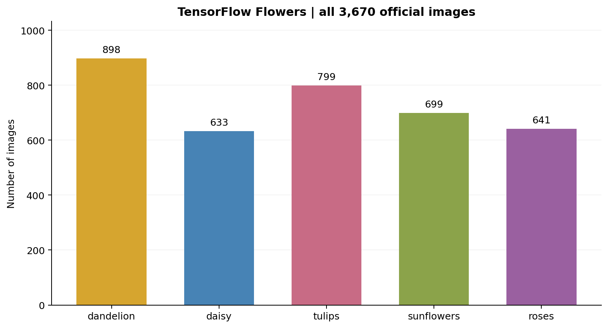

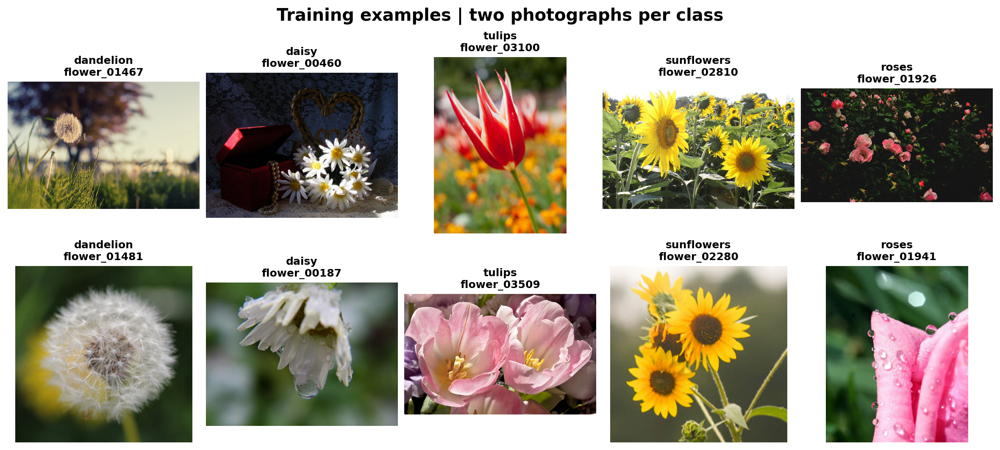

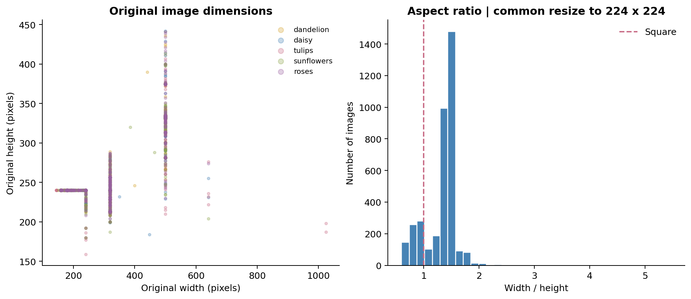

## 3. Методика та протокол

Feature extraction: ImageNet backbone без початкової голови + Global Average Pooling. MobileNetV2 формує 1280 ознак, ResNet50 формує 2048 ознак, VGG16 формує 512 ознак. Усі отримують RGB фото після resize до 224×224 без збереження пропорцій: це узгоджений базовий протокол, можливі спотворення форми.

MobileNetV2 preprocess_input масштабує значення до [-1, 1]; ResNet50 і VGG16 preprocess_input переставляють RGB у BGR і центрують за середніми ImageNet. CNN не навчаються під час отримання ознак. IDs зберігаються разом із X та y.

Logistic Regression: StandardScaler + C=1, max_iter=3000, lbfgs. SVM: StandardScaler + RBF, C=1, gamma=scale, probability=True. Random Forest: 300 дерев, max_features=sqrt, seed 42. Усі fit тільки на train, scaler теж train-only. Гіперпараметри задані до test.

Найкраща класична пара обирається серед 9 кандидатів за validation macro-F1, потім accuracy. Вибір записується перед test-прогнозами. Test-результати всіх пар — підсумковий benchmark, а не критерій перевибору.

Accuracy — частка правильних прогнозів; macro-F1 — середнє F1 пʼяти класів із рівними вагами; weighted-F1 враховує чисельність класів. Raw confusion matrix містить кількості, row-normalized — частки в межах істинного класу.

## 4. Результати benchmark

За validation macro-F1 вибрано ResNet50 + SVM RBF. Його test accuracy 89.84%, macro-F1 0.8971.

Найвища test accuracy серед фіксованих кандидатів — 91.11% у MobileNetV2 + SVM RBF та ResNet50 + Logistic Regression. Це описовий підсумок; переможця за validation не перевибираємо. Середня accuracy validation / test за трьома класифікаторами: ResNet50 90.61% / 90.32%, MobileNetV2 88.97% / 88.69% та VGG16 86.42% / 85.54%. Середня accuracy за трьома екстракторами: SVM RBF 89.27% / 88.81%, Logistic Regression 88.42% / 88.51% та Random Forest 88.30% / 87.24%.

На графіку вісь збільшено: різниці між парами становлять кілька відсоткових пунктів, тому стовпчики від нуля їх приховували б. Виділено пару, обрану за validation.

t-SNE проєктує тестові ознаки у 2D без використання міток; колір — справжній клас. Частка 10 найближчих сусідів того самого класу на площині (описова «чистота» кластерів): MobileNetV2 70%, ResNet50 72% та VGG16 66%; після донавчання MobileNetV2 — 82%. Fine-tuning робить класи компактнішими, ніж заморожені ImageNet-ознаки. Тюльпани й троянди перекриваються найбільше; кружками позначено тестові помилки обраних моделей. t-SNE — ілюстрація, а не метрика якості.

| Екстрактор | Класифікатор | Val acc | Val F1 | Test acc | Test F1 |
| --- | --- | --- | --- | --- | --- |
| MobileNetV2 | Logistic Regression | 88.73% | 0.8840 | 88.57% | 0.8839 |
| MobileNetV2 | SVM RBF | 90.36% | 0.9021 | 91.11% | 0.9097 |
| MobileNetV2 | Random Forest | 87.82% | 0.8757 | 86.39% | 0.8619 |
| ResNet50 | Logistic Regression | 90.36% | 0.9012 | 91.11% | 0.9091 |
| ResNet50 | SVM RBF | 90.91% | 0.9071 | 89.84% | 0.8971 |
| ResNet50 | Random Forest | 90.55% | 0.9038 | 90.02% | 0.8989 |
| VGG16 | Logistic Regression | 86.18% | 0.8591 | 85.84% | 0.8553 |
| VGG16 | SVM RBF | 86.55% | 0.8644 | 85.48% | 0.8513 |
| VGG16 | Random Forest | 86.55% | 0.8646 | 85.30% | 0.8497 |

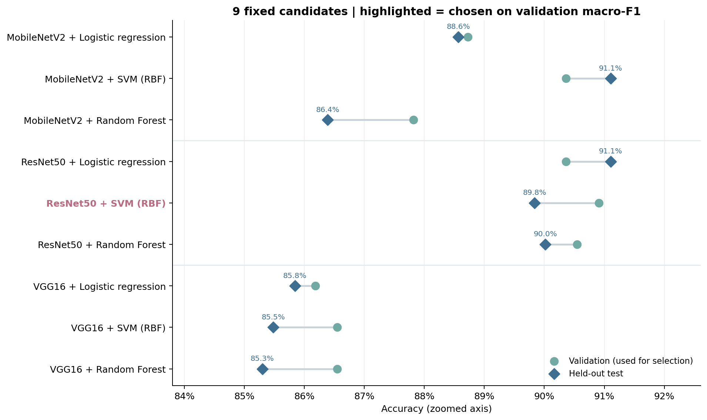

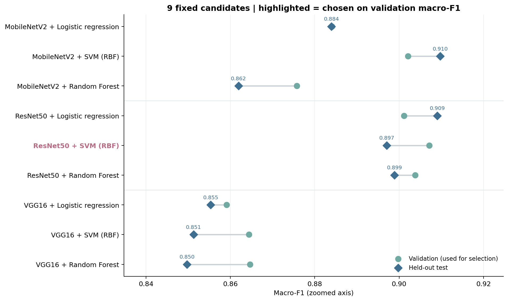

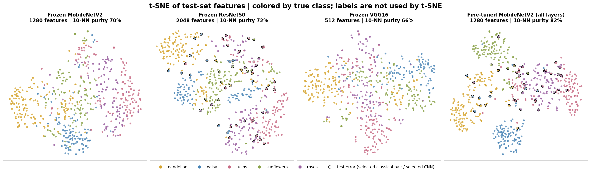

## 5. Матриці помилок

Рядки — справжні класи, стовпці — прогнози, діагональ — правильні рішення. Для кожної з 9 пар є raw і row-normalized матриця. У raw-матриць однакова шкала кольору; у normalized діапазон 0–100%, а діагональ дорівнює recall класу. Окремі PNG і CSV додаються для кожної пари.

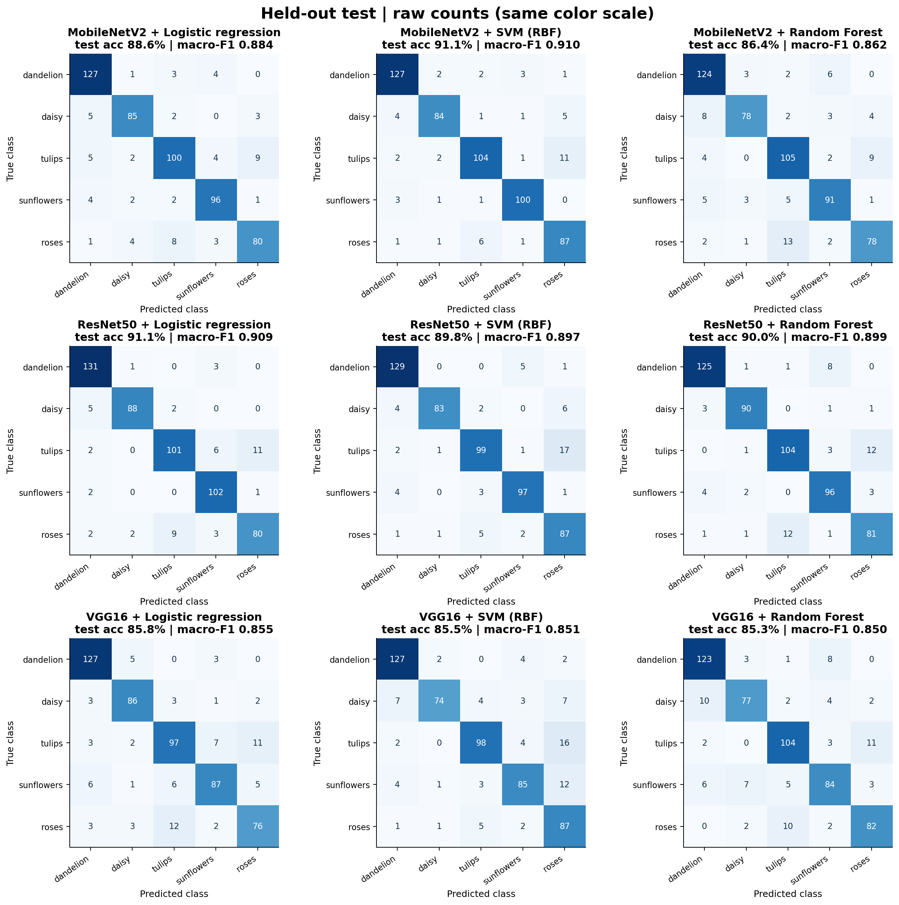

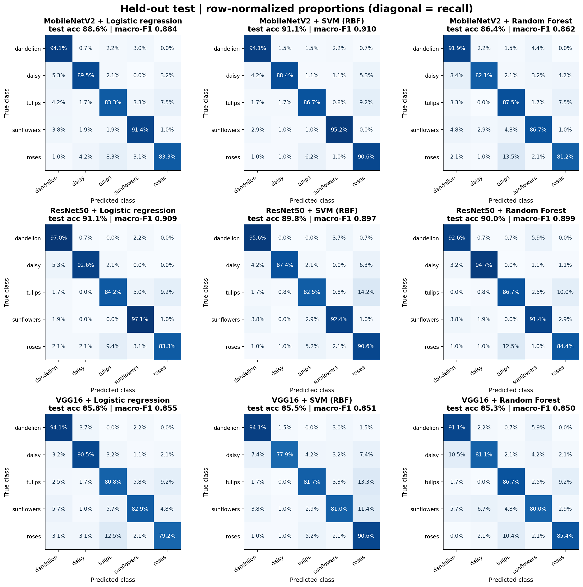

## 6. Залежність accuracy від глибини заморожених шарів

MobileNetV2 + Dropout(0.25) + Dense(5, softmax). Спільна голова прогріта 3 епохи з Adam 1e-3. Кожна політика стартує з тієї самої голови та ImageNet backbone, а не продовжує попередній режим.

Потім Adam 1e-5, максимум 6 епох, однакові перестановки train, EarlyStopping(val_loss, patience=2, restore_best_weights=True). Усі 52 BatchNorm frozen, backbone викликається з training=False. Кожен режим перекомпільовано з новим оптимізатором.

Незмінний префікс кешується у float32 (для повного розморожування — сам вхід), trainable суфікс справді донавчається. Враховано всі residual-ребра через межу; еквівалентність із повною мережею перевірено до й після fit. Аугментація відсутня.

Вісь X — фактичне число frozen шарів серед 155 шарів backbone, включно з BatchNorm і шарами без ваг. «Last k» — ширина кінцевого вікна, а не кількість навчуваних шарів: у таблиці окремо наведено trainable flags, шари з вагами й параметри.

Досліджено 9 режимів: від повністю замороженої MobileNetV2 (155 frozen, навчається лише голова) до розморожування всіх шарів, крім 52 BatchNorm (52 frozen). Validation accuracy змінюється від 89.09% до 92.55% (розмах 3.45 в. п.). Head-only дає 89.09%, найкращий режим («усі шари») — 92.55% (+3.45 в. п.). Загальна тенденція: що більше шарів розморожено, то вища точність, але крива немонотонна: перехід last 100 → last 115 знижує accuracy на 1.09 в. п. (6 фото). Різниці в кілька фото на validation з 550 зображень не слід переінтерпретувати.

Обрано режим «усі шари»: validation accuracy 92.55%, відновлена епоха 5. Тільки обрана політика отримала фінальну test-перевірку: accuracy 91.83%, macro-F1 0.9171.

Відтворюваність: режим last 20 повторно навчено на іншій машині для розширення; validation accuracy 90.55% проти 90.55%, macro-F1 0.9032 проти 0.9032.

| Режим | Frozen | Trainable flags | Шари з вагами | Trainable params | Епохи | Checkpoint | Val acc | Val F1 |
| --- | --- | --- | --- | --- | --- | --- | --- | --- |
| last 0 | 155 | 0 | 0 | 0 | 6 | 4 | 89.09% | 0.8887 |
| last 10 | 148 | 7 | 3 | 725 440 | 6 | 6 | 90.36% | 0.9009 |
| last 20 | 142 | 13 | 6 | 1 041 280 | 6 | 6 | 90.55% | 0.9032 |
| last 35 | 132 | 23 | 12 | 1 608 064 | 4 | 2 | 90.55% | 0.9034 |
| last 50 | 122 | 33 | 16 | 1 779 136 | 4 | 2 | 91.27% | 0.9107 |
| last 75 | 105 | 50 | 25 | 2 012 416 | 4 | 2 | 91.27% | 0.9112 |
| last 100 | 89 | 66 | 33 | 2 131 648 | 6 | 5 | 92.18% | 0.9204 |
| last 115 | 79 | 76 | 38 | 2 157 952 | 4 | 2 | 91.09% | 0.9094 |
| усі шари | 52 | 103 | 52 | 2 189 760 | 6 | 5 | 92.55% | 0.9238 |

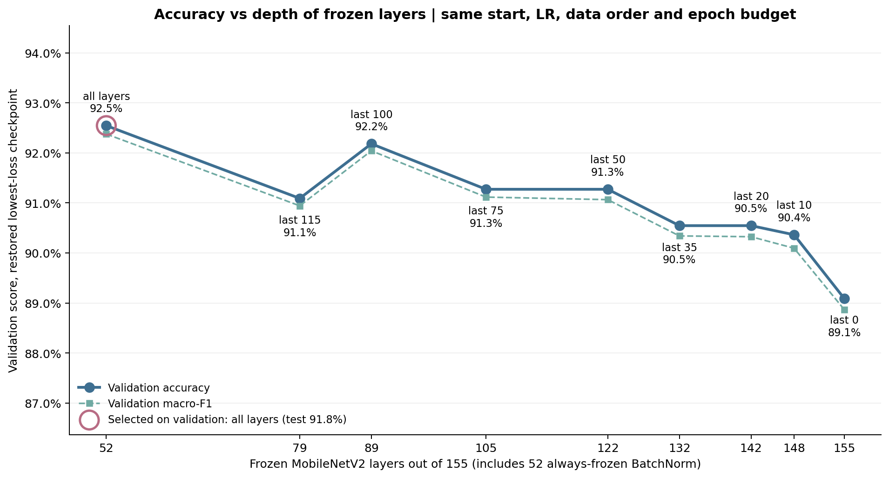

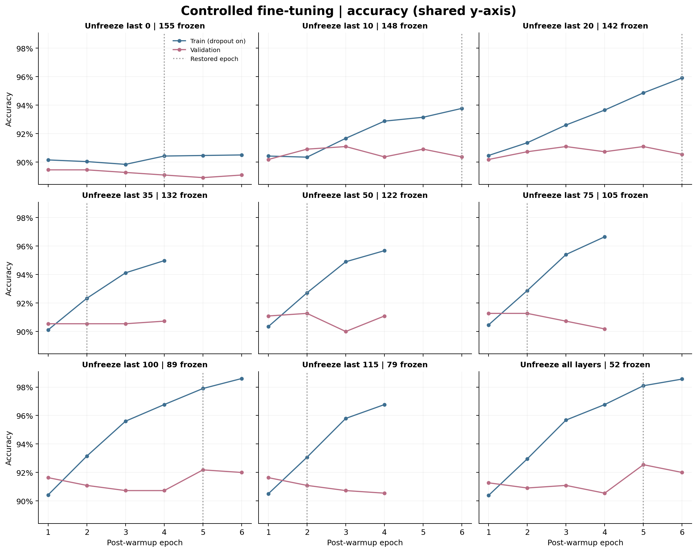

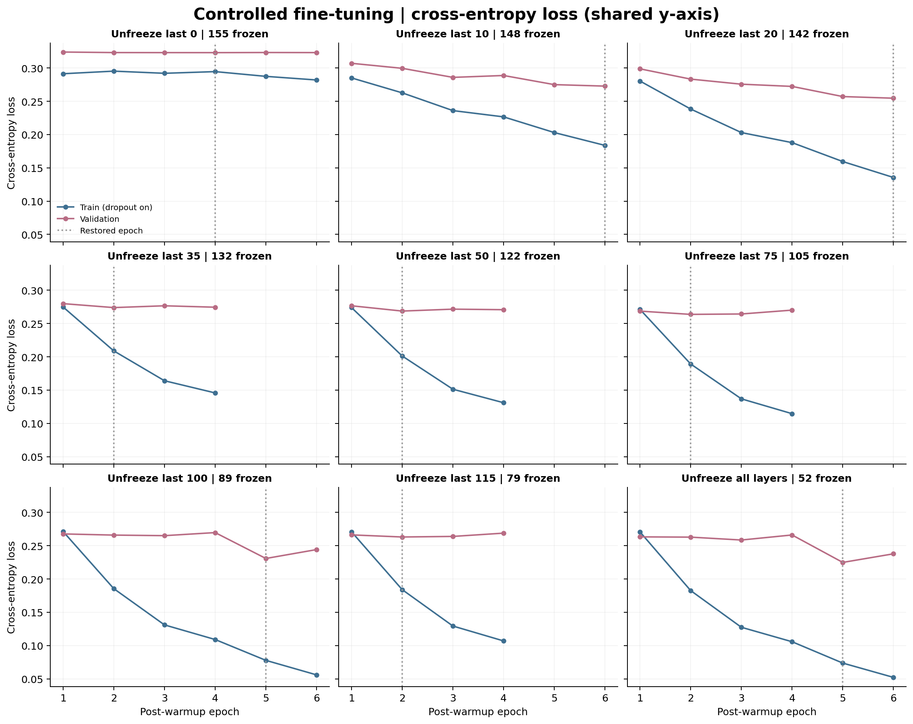

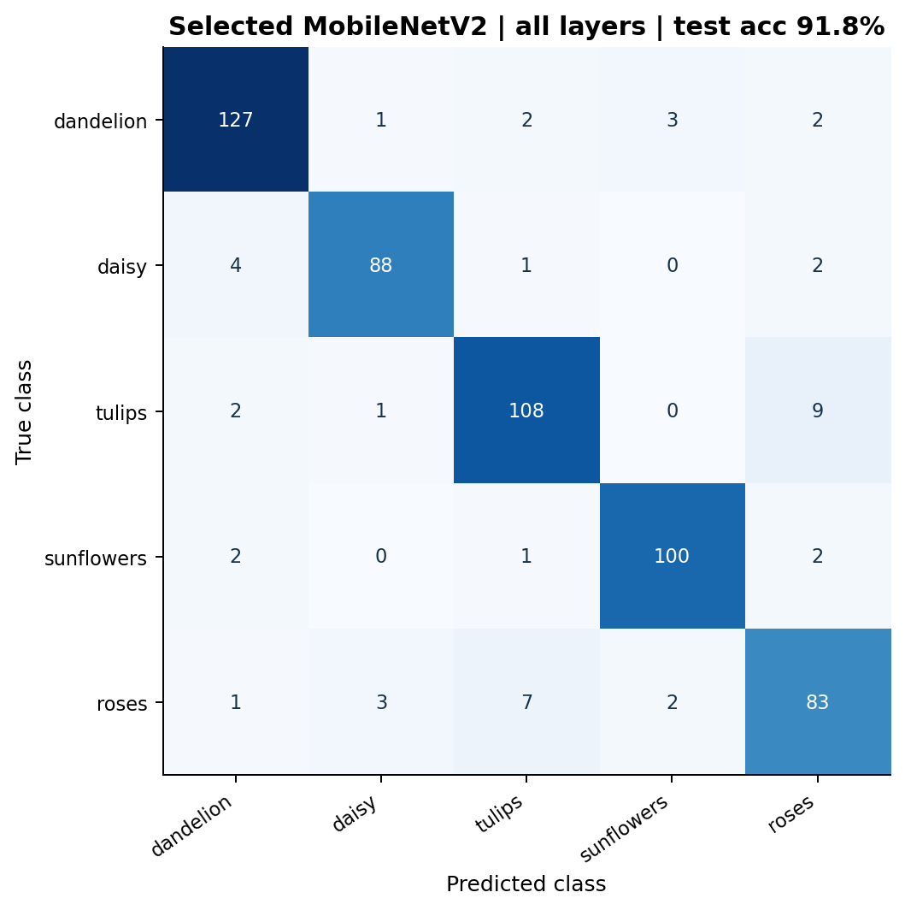

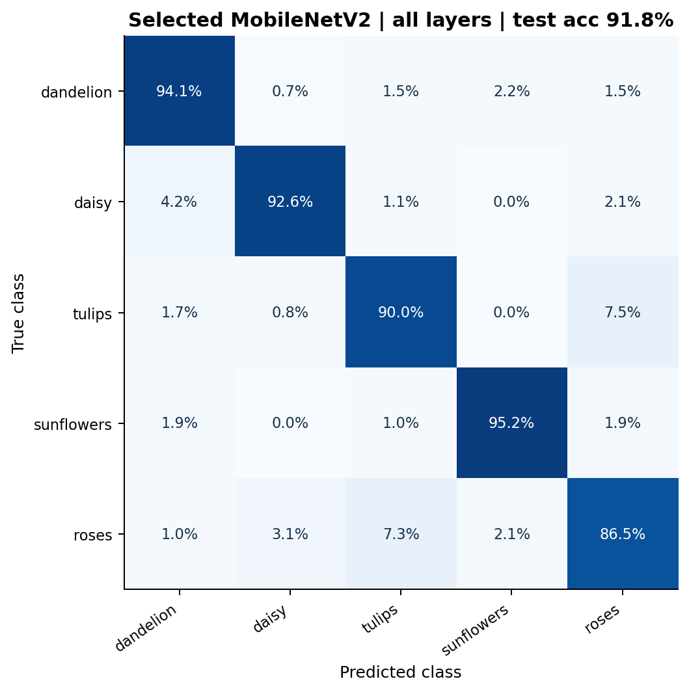

## 7. Характерні помилки та спостереження

Найчастіша пара обраної моделі — tulips → roses: 17 помилок із 120 (14.17%). Зворотний напрям має 5 випадків.

Щоб перевірити, чи помилки систематичні, ті самі клітинки порахували для всіх класичних пар і обраної CNN. Три найчастіші в середньому: tulips → roses (11.9, від 9 до 17; CNN 9); roses → tulips (8.9, від 5 до 13; CNN 7); daisy → dandelion (5.4, від 3 до 10; CNN 4).

Переглянуті фото згруповано за причинами: схожі класи (махрові тюльпани й бутони троянд), кілька видів у кадрі, малий обʼєкт на складному фоні, нетиповий ракурс або світло, а також проблеми розмітки. На flower_01581 видно тюльпани з міткою roses, на flower_01983 — гербери, яких немає серед пʼяти класів. Такі «помилки» з високою confidence — радше шум офіційних міток.

Візуальні пояснення є гіпотезами за переглядом фото, а не встановленими внутрішніми причинами CNN. Букети flower_03563 і flower_03564 — майже-дублікати, тому не є незалежними доказами.

Confidence дорівнює predict_proba саме передбаченого класу. SVC.predict інколи відрізняється від argmax probability; у CSV збережено справжнє рішення. Confidence не є гарантією правильності.

| true_class | pred_class | count |
| --- | --- | --- |
| tulips | roses | 17 |
| daisy | roses | 6 |
| dandelion | sunflowers | 5 |
| roses | tulips | 5 |
| daisy | dandelion | 4 |
| sunflowers | dandelion | 4 |
| sunflowers | tulips | 3 |
| daisy | tulips | 2 |
| roses | sunflowers | 2 |
| tulips | dandelion | 2 |

| image_id | true_class | pred_class | error_category | confidence |
| --- | --- | --- | --- | --- |
| flower_03564 | tulips | roses | Кілька видів у кадрі | 99.0% |
| flower_03563 | tulips | roses | Кілька видів у кадрі | 95.0% |
| flower_03645 | tulips | roses | Схожі класи | 94.2% |
| flower_03530 | tulips | roses | Схожі класи | 89.7% |
| flower_00293 | daisy | roses | Малий обʼєкт / складний фон | 46.6% |
| flower_00434 | daisy | roses | Ракурс, світло або обробка фото | 35.5% |
| flower_00077 | daisy | roses | Малий обʼєкт / складний фон | 33.4% |
| flower_00486 | daisy | roses | Ракурс, світло або обробка фото | 29.5% |
| flower_00946 | dandelion | sunflowers | Ракурс, світло або обробка фото | 59.0% |
| flower_01581 | roses | tulips | Анотація / поза класом | 99.7% |
| flower_01983 | roses | sunflowers | Анотація / поза класом | 97.8% |
| flower_01692 | roses | tulips | Схожі класи | 97.5% |
| flower_02227 | sunflowers | dandelion | Ракурс, світло або обробка фото | 97.2% |
| flower_02826 | sunflowers | dandelion | Малий обʼєкт / складний фон | 92.5% |
| flower_00158 | daisy | dandelion | Ракурс, світло або обробка фото | 92.5% |
| flower_00410 | daisy | dandelion | Ракурс, світло або обробка фото | 90.3% |
| flower_01441 | dandelion | sunflowers | Анотація / поза класом | 88.2% |

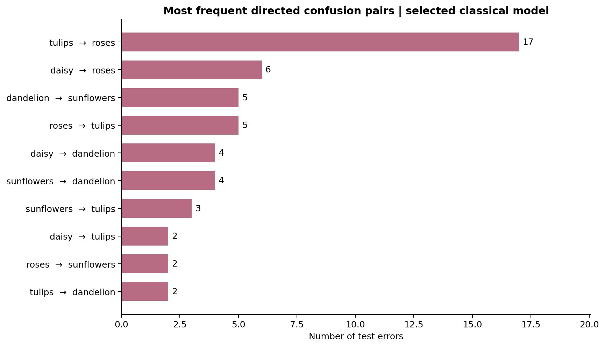

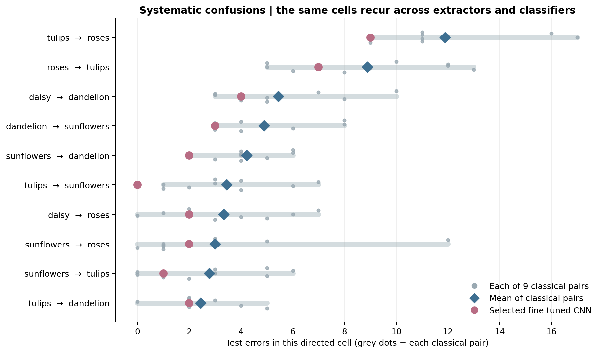

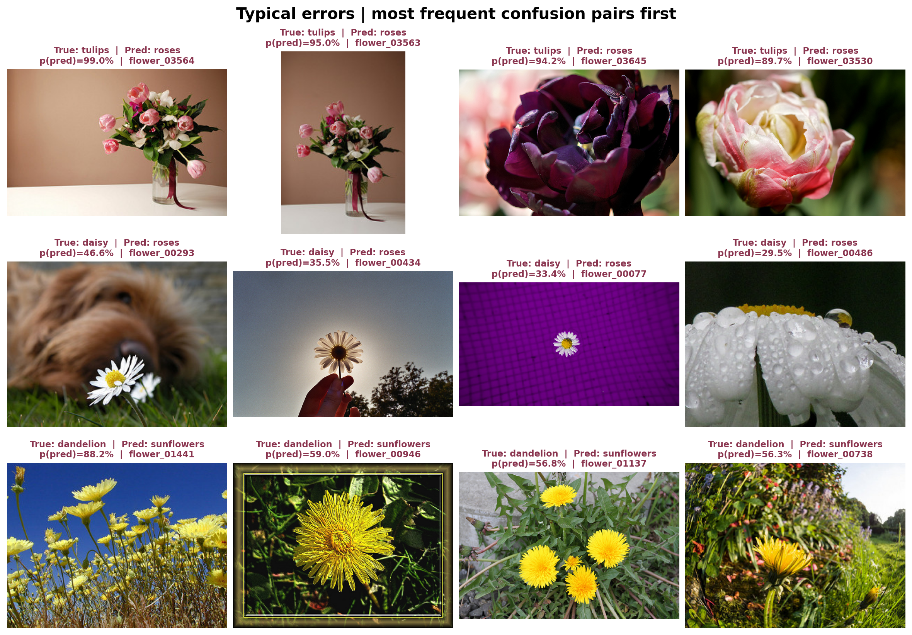

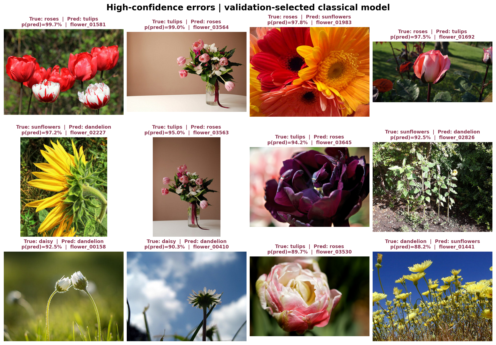

## 8. Перевірки та обмеження

Виконано автоматичні перевірки (103): відсутність shared hashes між split, узгодженість IDs/labels, перерахунок метрик і матриць із прогнозів, повторне завантаження estimator, train-only scaler, правильний val ranking, зміна лише дозволених ваг CNN і наявність усіх рисунків. Усі пройдено.

Середовище: Python 3.12, TensorFlow CPU 2.20.0, Keras 3.15.1, scikit-learn 1.8.0, без GPU. Дати запуску: 31.10.2026 (основний запуск) та 01.11.2026 (розширення: VGG16 і додаткові режими заморожування). Час у CSV є журналом запуску, а не строгим speed benchmark.

Обмеження: один seed і один split, скінченний test на 551 фото, можливі майже-дублікати й шум міток, лише пʼять класів, немає external test і reject-класу. Формальної перевірки статистичної переваги не проводили.

## 9. Висновки за фактичним запуском

1. Порівняно 9 пар екстрактор–класифікатор (3 CNN × 3 класифікатори) на 2569 train / 550 validation / 551 test. Розмір вектора ознак: MobileNetV2 — 1280, ResNet50 — 2048, VGG16 — 512. Єдине розбиття, масштабування лише на train й однакові метрики роблять порівняння узгодженим.

2. За validation macro-F1 вибрано **ResNet50 + SVM RBF**: validation accuracy **90.91%**, validation macro-F1 **0.9071**. Для цієї зафіксованої пари test accuracy становить **89.84%**, macro-F1 — **0.8971** (495 правильних із 551).

3. Найвищу test accuracy серед 9 фіксованих пар показали MobileNetV2 + SVM RBF та ResNet50 + Logistic Regression: **91.11%**. Цей описовий результат не використано для перевибору моделі; ranking на validation не зобовʼязаний повторитися на test. Середня accuracy validation / test за трьома класифікаторами: ResNet50 90.61% / 90.32%, MobileNetV2 88.97% / 88.69% та VGG16 86.42% / 85.54%. Середня accuracy за трьома екстракторами: SVM RBF 89.27% / 88.81%, Logistic Regression 88.42% / 88.51% та Random Forest 88.30% / 87.24%.

4. Accuracy trend: досліджено 9 режимів: від повністю замороженої MobileNetV2 (155 frozen, навчається лише голова) до розморожування всіх шарів, крім 52 BatchNorm (52 frozen). Validation accuracy змінюється від 89.09% до 92.55% (розмах 3.45 в. п.). Head-only дає 89.09%, найкращий режим («усі шари») — 92.55% (+3.45 в. п.). Загальна тенденція: що більше шарів розморожено, то вища точність, але крива немонотонна: перехід last 100 → last 115 знижує accuracy на 1.09 в. п. (6 фото). Різниці в кілька фото на validation з 550 зображень не слід переінтерпретувати.

5. Обрана за validation CNN (усі шари, checkpoint епохи **5**) дала **91.83%** test accuracy та **0.9171** macro-F1 (506 правильних із 551). Серед 9 класичних пар максимум був 502/551. Це результати одного split, формально статистичну перевагу не доведено.

6. Найчастіша помилка обраної класичної пари: **tulips → roses, 17 фото**, тобто 17/120 = **14.17%** цього класу; зворотний напрям — 5. Ця ж клітинка є найчастішою й у середньому по всіх 9 класичних парах (11.9 помилки; від 9 до 17), а в обраної CNN — 9. Отже, плутанина tulips/roses систематична, а не випадкова для одного алгоритму.

7. У 17 переглянутих хибних прогнозах виділено причини: ракурс, світло або обробка фото (6), малий обʼєкт / складний фон (3), схожі класи (3), анотація / поза класом (3) та кілька видів у кадрі (2). Частина найвпевненіших «помилок» — це, найімовірніше, неточні офіційні мітки або квіти поза пʼятьма класами; модель без reject-класу все одно вибирає один із пʼяти.

8. Три пари точних дублікатів не перетинають split; одна пара з різними мітками збережена в train. Обмеження: один seed і split, майже-дублікати не усувалися вичерпно, можливі помилки анотації, немає зовнішнього test і reject-класу.

## Джерела

1. [Умови викладача, Labs.pdf, слайд 14](https://github.com/dryabokon/Docs/blob/master/ML/Labs.pdf)
2. [TFDS TensorFlow Flowers](https://www.tensorflow.org/datasets/catalog/tf_flowers)
3. [TFDS: код датасету й порядок міток](https://github.com/tensorflow/datasets/blob/master/tensorflow_datasets/datasets/tf_flowers/tf_flowers_dataset_builder.py)
4. [Keras: Transfer learning & fine-tuning](https://keras.io/guides/transfer_learning/)
5. [Keras: MobileNetV2](https://keras.io/api/applications/mobilenet/mobilenet_models/)
6. [Keras: ResNet](https://keras.io/api/applications/resnet/)
7. [Keras: VGG16](https://keras.io/api/applications/vgg/)
8. [scikit-learn: model evaluation](https://scikit-learn.org/stable/modules/model_evaluation.html)
9. [scikit-learn: t-SNE](https://scikit-learn.org/stable/modules/generated/sklearn.manifold.TSNE.html)

Атрибуція фото: `data/FLOWERS_LICENSE.txt`. CSV, усі 36 PNG та моделі включені в проєкт.